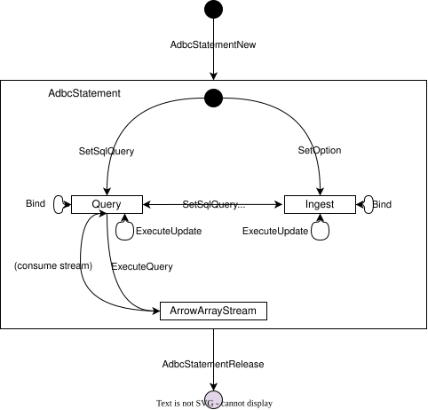
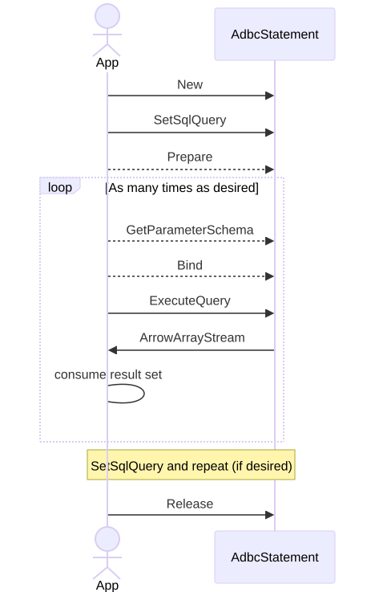
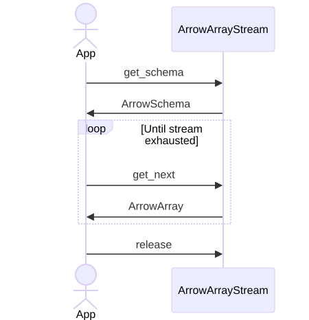
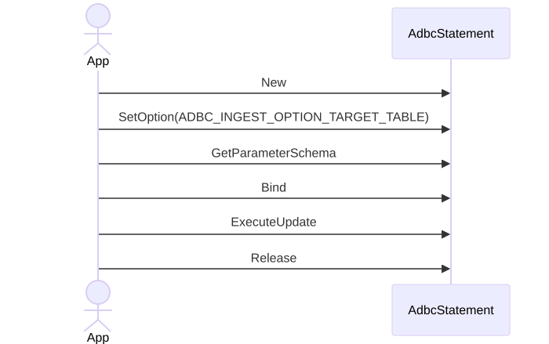
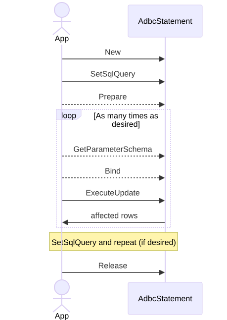
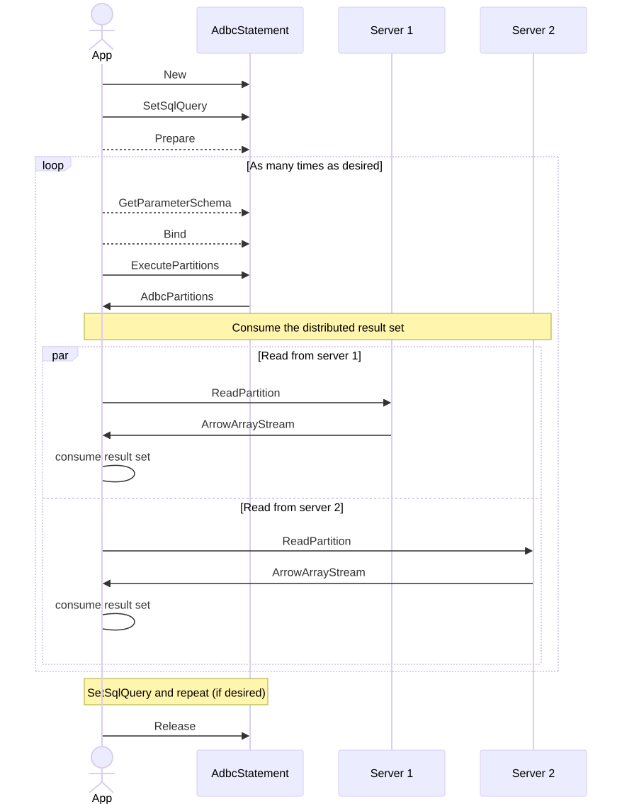

.. Licensed to the Apache Software Foundation (ASF) under one
.. or more contributor license agreements.  See the NOTICE file
.. distributed with this work for additional information
.. regarding copyright ownership.  The ASF licenses this file
.. to you under the Apache License, Version 2.0 (the
.. "License"); you may not use this file except in compliance
.. with the License.  You may obtain a copy of the License at
..
..   http://www.apache.org/licenses/LICENSE-2.0
..
.. Unless required by applicable law or agreed to in writing,
.. software distributed under the License is distributed on an
.. "AS IS" BASIS, WITHOUT WARRANTIES OR CONDITIONS OF ANY
.. KIND, either express or implied.  See the License for the
.. specific language governing permissions and limitations
.. under the License.

=================
ADBC API Standard
=================

This document summarizes the general featureset of the ADBC API and should be considered informative only.

For authoritative definitions of the ADBC API, refer to the following sources:

- For C/C++ details, see :external+cpp_adbc:doc:`adbc.h`.
- For Go details, see the `source <https://github.com/apache/arrow-adbc/blob/main/go/adbc/adbc.go>`__.
- For Java details, see the `source
  <https://github.com/apache/arrow-adbc/tree/main/java/core>`__, particularly
  the package :jpackage:`org.apache.arrow.adbc.core`.

:external+cpp_adbc:doc:`adbc.h`. is considered canonical.

Databases
=========

Databases hold state shared by multiple connections.  Generally, this
means common configuration and caches.  For in-memory databases, it
provides a place to hold ownership of the in-memory database.

- C/C++: :c:struct:`AdbcDatabase`
- Go: ``Driver``
- Java: :jtype:`org.apache.arrow.adbc.core.AdbcDatabase`

Connections
===========

A connection is a single, logical connection to a database.

- C/C++: :c:struct:`AdbcConnection`
- Go: ``Connection``
- Java: :jtype:`org.apache.arrow.adbc.core.AdbcConnection`

Autocommit
----------

By default, connections are expected to operate in autocommit mode;
that is, queries take effect immediately upon execution.  This can be
disabled in favor of manual commit/rollback calls, but not all
implementations will support this.

- C/C++: :c:macro:`ADBC_CONNECTION_OPTION_AUTOCOMMIT`
- Go: ``OptionKeyAutoCommit``
- Java: :jmember:`org.apache.arrow.adbc.core.AdbcConnection#setAutoCommit(boolean)`

.. _specification-credential-refresh:

Credential Refresh
------------------

.. note:: Since API revision 1.2.0

Drivers may support an application-provided callback to acquire updated
credentials after an authentication failure.  This complements driver-managed
refresh when credential acquisition requires application-specific services.
It can also allow fetching an existing result stream to continue without
opening a new connection.

In C, applications register a :c:type:`AdbcCredentialHandler` using
:c:func:`AdbcConnectionSetCredentialHandler`.  The callback receives a borrowed,
read-only source error.  Its details identify the requested credential and
the expected response; drivers should use
:ref:`specification-typed-error-details` to describe this context.

The callback returns updated credentials as a single-row Arrow record batch
through output-only schema and array parameters.  A separate output error
describes acquisition failures without modifying the source error.  The
driver owns and releases all populated outputs, regardless of success.
Returning :c:macro:`ADBC_STATUS_NOT_IMPLEMENTED` declines the request and
preserves the original failure.  Other failure statuses stop the refresh
attempt and are reported with the callback's error, if provided, or the
original diagnostic otherwise.

Callbacks may block and run on any thread, but are serialized per connection.
Successful replacement or removal of a handler, and connection release, wait
for outstanding invocations before the application can release callback state.
Applications must not reenter the connection from the callback.

Refreshing credentials does not authorize unsafe retries.  Drivers must not
replay potentially executed statements or duplicate or omit result rows.
Only one callback and retry are permitted for a single failed request;
subsequent requests may independently need refreshed credentials.

Metadata
--------

ADBC exposes a variety of metadata about the database, such as what catalogs,
schemas, and tables exist, the Arrow schema of tables, and so on.

.. _specification-statistics:

Statistics
----------

.. note:: Since API revision 1.1.0

ADBC exposes table/column statistics, such as the (unique) row count, min/max
values, and so on.  The goal here is to make ADBC work better in federation
scenarios, where one query engine wants to read Arrow data from another
database.  Having statistics available lets the "outer" query planner make
better choices about things like join order, or even decide to skip reading
data entirely.

Statements
==========

Statements hold state related to query execution.  They represent both
one-off queries and prepared statements.  They can be reused, though
doing so will invalidate prior result sets from that statement.  (See
:doc:`../../cpp/concurrency`.)

- C/C++: :c:struct:`AdbcStatement`
- Go: ``Statement``
- Java: ``org.apache.arrow.adbc.core.AdbcStatement``

.. _specification-bulk-ingestion:

Bulk Ingestion
--------------

ADBC provides explicit facilities to ingest batches of Arrow data into
a database table.  For databases which support it, this can avoid
overheads from the typical bind-insert loop.  Also, this (mostly)
frees the user from knowing the right SQL syntax for their database.

- C/C++: :c:macro:`ADBC_INGEST_OPTION_TARGET_TABLE` and related
  options.
- Go: ``OptionKeyIngestTargetTable``
- Java: ``org.apache.arrow.adbc.core.AdbcConnection#bulkIngest(String, org.apache.arrow.adbc.core.BulkIngestMode)``

.. _specification-cancellation:

Cancellation
------------

.. note:: Since API revision 1.1.0

Queries (and operations that implicitly represent queries, like fetching
:ref:`specification-statistics`) can be cancelled.

Partitioned Result Sets
-----------------------

ADBC lets a driver explicitly expose partitioned and/or distributed
result sets to clients.  (This is similar to functionality in Flight
RPC/Flight SQL.)  Clients may take advantage of this to distribute
computations on a result set across multiple threads, processes, or
machines.

- C/C++: :c:func:`AdbcStatementExecutePartitions`
- Go: ``Statement.ExecutePartitions``
- Java: ``org.apache.arrow.adbc.core.AdbcStatement#executePartitioned()``

.. _specification-incremental-execution:

In principle, a vendor could return the results of partitioned execution as
they are available, instead of all at once.  Incremental execution allows
drivers to expose this.  When enabled, each call to ``ExecutePartitions`` will
return available endpoints to read instead of blocking to retrieve all
endpoints.

.. note:: Since API revision 1.1.0

Lifecycle & Usage
-----------------

Basic Usage
~~~~~~~~~~~

   Preparing the statement and binding parameters are optional.

Consuming Result Sets
~~~~~~~~~~~~~~~~~~~~~

   This is equivalent to reading from what many Arrow libraries call a
   RecordBatchReader.

Bulk Data Ingestion
~~~~~~~~~~~~~~~~~~~

   There is no need to prepare the statement.

Update-only Queries (No Result Set)
~~~~~~~~~~~~~~~~~~~~~~~~~~~~~~~~~~~

   Preparing the statement and binding parameters are optional.

Partitioned Execution
~~~~~~~~~~~~~~~~~~~~~

   This is similar to fetching data in Arrow Flight RPC (by design). See
   :doc:`"Downloading Data" <arrow:format/Flight>`.

Error Handling
==============

The error handling strategy varies by language.

In C, most methods take a :c:struct:`AdbcError`.  In Go, most methods return
an error that can be cast to an ``AdbcError``.  In Java, most methods raise an
``AdbcException``.

In all cases, an error contains:

- A status code,
- An error message,
- An optional vendor code (a vendor-specific status code),
- An optional 5-character "SQLSTATE" code (a SQL-like vendor-specific code).

.. _specification-rich-error-metadata:

Rich Error Metadata
-------------------

.. note:: Since API revision 1.1.0

Drivers can expose additional rich error metadata.  This can be used to return
structured error information.  For example, a driver could use something like
the `Googleapis ErrorDetails`_.

In C, Go and Java, :c:struct:`AdbcError`, ``AdbcError``, and
``AdbcException`` respectively expose a list of additional metadata.  For C,
see the documentation of :c:struct:`AdbcError` to learn how the struct was
expanded while preserving ABI.

.. _Googleapis ErrorDetails: https://github.com/googleapis/googleapis/blob/master/google/rpc/error_details.proto

.. _specification-typed-error-details:

Strongly-Typed Error Details
~~~~~~~~~~~~~~~~~~~~~~~~~~~~

Drivers may expose structured error details using the existing rich error
metadata API, without changing its binary values or requiring a new API.
The following well-known keys together encode an unshredded `Parquet Variant`_:

- ``adbc.error_details.metadata`` contains the Variant metadata bytes.
- ``adbc.error_details.value`` contains the Variant value bytes.

Both keys must be present together and occur at most once each.  The Variant
must contain an object mapping detail names to typed values.  Names and their
meanings are driver-defined unless standardized by ADBC, and clients must
ignore unrecognized fields.  A missing component or invalid encoding must
not be treated as an empty detail object.  The bytes have the same ownership
and lifetime as other error metadata.

Drivers may continue exposing other error detail keys, including legacy
representations of the same information.  Duplicated values should agree.
This convention is introduced with API revision 1.2.0 but can also be used by
1.1.0 implementations; no existing error detail API is deprecated.

In C, the keys are defined by :c:macro:`ADBC_ERROR_DETAILS_METADATA` and
:c:macro:`ADBC_ERROR_DETAILS_VALUE`.

.. _Parquet Variant: https://github.com/apache/parquet-format/blob/master/VariantEncoding.md

Changelog
=========

Version 1.2.0 (Draft)
---------------------

:ref:`specification-credential-refresh` adds an optional connection callback
for application-managed credential acquisition, with immutable error input
and separate credential and error outputs.

:ref:`specification-typed-error-details` defines a backwards-compatible
convention for carrying typed error details as a Parquet Variant.

Version 1.1.0
-------------

The info key ADBC_INFO_DRIVER_ADBC_VERSION can be used to retrieve the
driver's supported ADBC version.

The canonical options "uri", "username", and "password" were added to make
configuration consistent between drivers.

:ref:`specification-cancellation` and the ability to both get and set options
of different types were added.  (Previously, you could set string options but
could not get option values or get/set values of other types.)  This can be
used to get and set the current active catalog and/or schema through a pair of
new canonical options.

:ref:`specification-bulk-ingestion` supports two additional modes:

- "adbc.ingest.mode.replace" will drop existing data, then behave like
  "create".
- "adbc.ingest.mode.create_append" will behave like "create", except if the
  table already exists, it will not error.

:ref:`specification-rich-error-metadata` has been added, allowing clients to
get additional error metadata.

The ability to retrieve table/column :ref:`statistics
<specification-statistics>` was added.  The goal here is to make ADBC work
better in federation scenarios, where one query engine wants to read Arrow
data from another database.

:ref:`Incremental execution <specification-incremental-execution>` allows
streaming partitions of a result set as they are available instead of blocking
and waiting for query execution to finish before reading results.
